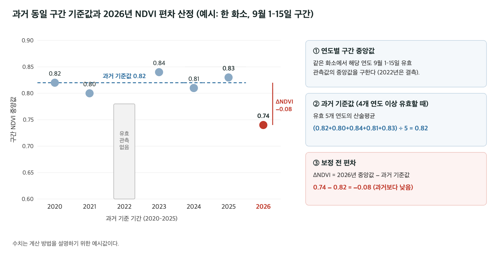
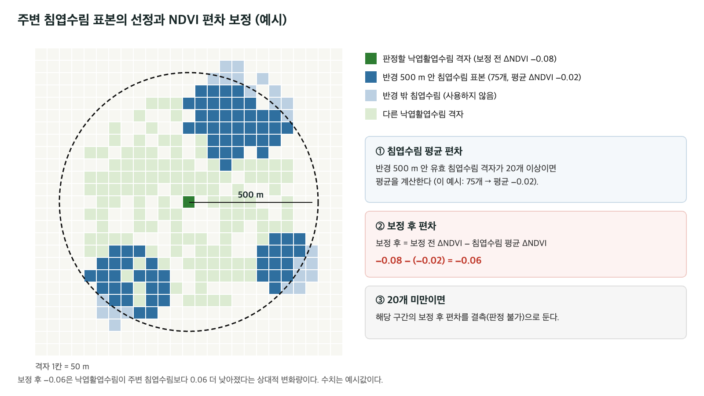
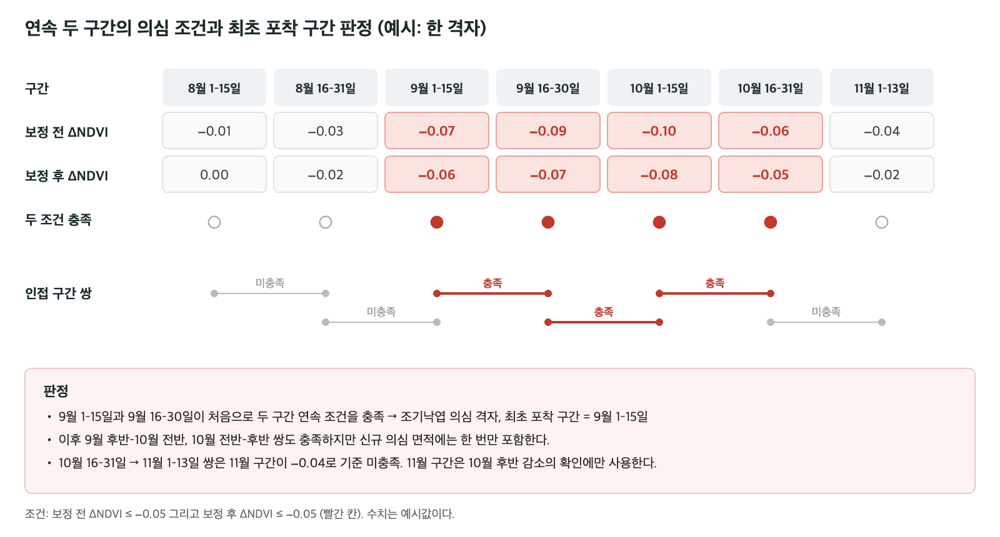
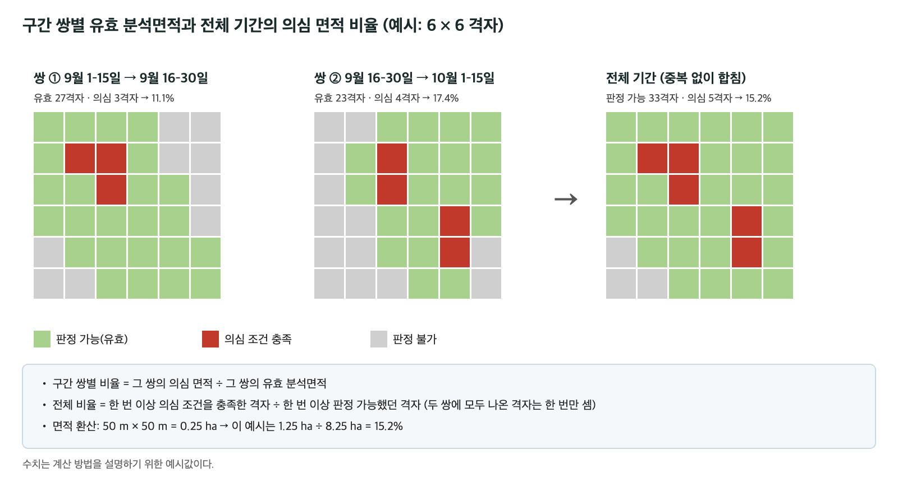
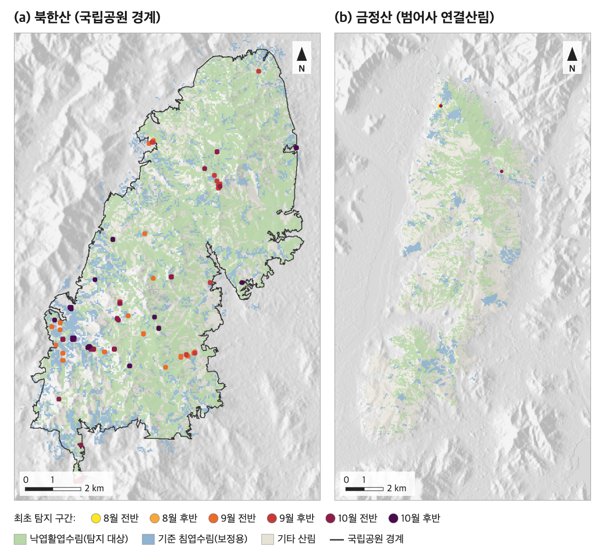
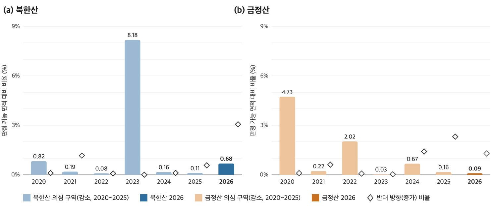
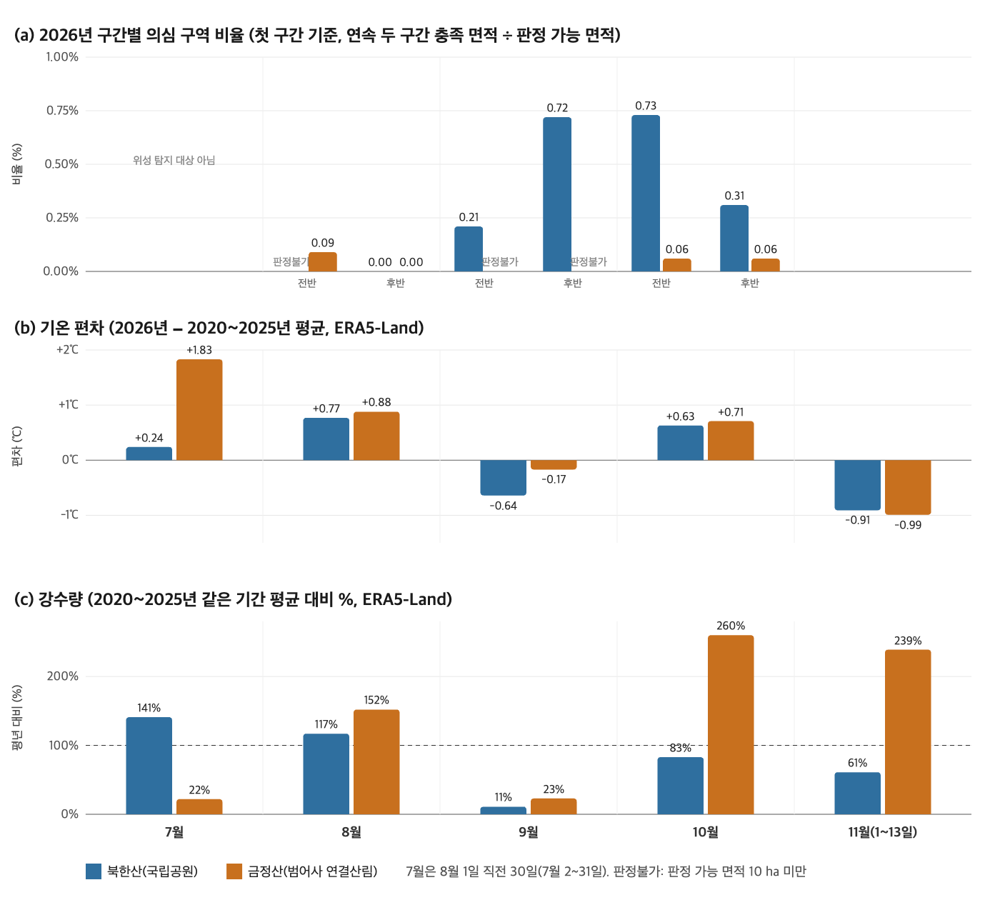

> 현재 연구 배경부터 결과까지 작성하였습니다. 토의·결론은 결과를 바탕으로 작성할 예정입니다. 저장소의 `01_공통코드`~`03_분석결과` 폴더에 들어 있는 예제 코드·그림·수치는 교수님 템플릿의 합성자료이며, 7조의 실제 분석 결과가 아닙니다.

### 초록
작성 예정. 연구목적·자료·방법·주요 결과·해석을 분석 완료 후 요약합니다.

**주제어:** 조기낙엽, Sentinel-2, NDVI, 북한산, 금정산, 기온·강수

## 1. 연구 배경 {#background}
2026년 10월, 북한산 저지대 일부에서 단풍이 들기 전에 잎이 갈색으로 말라붙고 일찍 떨어지는 모습이 보도되었다. 보도는 여름철 폭염과 9월 강수 감소에 따른 수분 스트레스를 가능한 배경으로 제시하면서도, 북한산 전체에서 동일한 현상이 나타난 것은 아니라고 설명하였다(김민경, 2026). 이는 일부 지점에서 관찰된 변화가 산림의 어느 범위까지 나타났는지, 정상적인 계절 변화와 어떻게 다른지 살펴볼 필요성을 제기한다. 다만 이 보도만으로 북한산 전체의 조기낙엽 발생 규모나 원인을 판단할 수는 없다.

*그림 1. YTN 「북한산 단풍 절정인데...말라붙은 잎에 '조기 낙엽'까지」(2026.10.30, 기사 제목 부분 캡처)*

조기낙엽에 주목해야 하는 이유는 단풍 경관이 달라졌다는 데만 있지 않다. 특정 조건에서 나타나는 이른 잎의 노화와 낙엽은 이후 수목 상태를 주의 깊게 살펴볼 단서가 될 수 있다. Frei et al.(2022)은 2018년 가뭄 당시 스위스 북부에서 잎이 일찍 노화한 유럽너도밤나무를 2021년까지 추적하였다. 그 결과 이 나무들은 정상 시기에 노화한 나무보다 이후 수관의 가지 고사와 나무 전체의 고사 비율이 높았고 회복도 느렸다. Descals et al.(2023)의 유럽 낙엽수림 연구에서도 이른 낙엽이 나타난 지역은 이후 연도의 여름철 평균 식생지수가 감소하는 경향을 보였다. 이러한 결과를 국내 산림에 그대로 적용할 수는 없다. 그러나 이른 식생 변화를 일시적인 경관 변화로만 취급하지 않고, 이후 상태를 확인할 대상으로 기록할 필요성을 뒷받침한다.

나아가 이러한 산림 식생의 이른 쇠퇴는 생태적 차원을 넘어 경제적 관리 비용과 자원 가치의 문제로도 이어진다. 국립산림과학원(2023)의 2020년 기준 평가에 따르면 우리나라 산림의 공익적 가치는 연간 259조 원에 달하며, 이 중 온실가스 흡수·저장 기능은 97.6조 원이다. 따라서 북한산이나 금정산처럼 대도시와 인접해 이용객이 많은 산림에서 잎이 일찍 마르고 떨어지면, 단풍 경관의 질 저하는 물론 탄소 흡수 등 산림이 제공하는 생태계 서비스의 경제적 가치가 감소할 수 있다. 또한 수목 쇠약이 누적되어 고사나 병해충 피해로 확산될 경우 막대한 사후 대응 비용이 발생하는데, 실제로 산림청(2026)은 2026년 한 해 소나무재선충병 방제에만 약 2,000억 원의 국비를 투입할 계획이다. 이러한 점에 비추어 볼 때, 피해가 광범위하게 진행된 이후에 복구 비용을 투입하기보다 이상 징후가 나타난 구역을 조기에 파악하여 한정된 산림 관리 예산과 인력을 우선 투입할 대상을 선별하는 작업은 경제적·관리적 측면에서 실용적인 의의를 가진다.

이때 필요한 정보는 현상의 존재 여부뿐 아니라 분포와 범위, 나타나기 시작한 시기이다. 변화가 관찰된 위치를 기록하면 이후 현장 확인과 재관찰의 대상을 정하는 데 참고할 수 있다. 면적과 시기를 함께 파악하면 변화가 일부 구역에 국한되었는지, 여러 구역에서 비슷한 시기에 나타났는지 구분할 수 있다. 따라서 이러한 정보를 확보하는 일은 산림 피해를 곧바로 판정하기 위한 것이 아니라, 추가적인 상태 확인이 필요한 구역을 살펴보기 위한 기초자료를 마련한다는 의미가 있다. 북한산 보도는 현장 모습을 보여 주지만, 보도만으로는 분석 대상 산림 전체의 분포와 면적, 변화의 시작 시기를 파악하기 어렵다.

이러한 정보의 부족을 보완하는 데 반복적으로 촬영된 위성영상을 활용할 수 있다. Descals et al.(2023)은 이른 낙엽이 작은 산림 구역에서 나타나고 정상적인 계절 변화와 구별할 수 있는 기간도 짧아, 발생 범위와 반복 양상을 파악하기 어렵다고 설명하였다. 이들은 Sentinel-2 자료를 이용하여 2017~2021년 유럽 산림의 이른 낙엽 분포와 시기를 관측하였다. Brun et al.(2020)도 Sentinel-2 식생지수 시계열과 육안으로 분류한 관측자료를 결합해 2018년 중부 유럽 산림의 이른 잎 마름과 낙엽 분포를 분석하였다. 이러한 사례는 위성영상이 현장 관찰을 대신해 낙엽을 확정하는 수단이라기보다, 개별 관찰 지점을 넘어 공간적 범위와 시간적 변화를 살펴보는 자료가 될 수 있음을 보여 준다. 특히 반복 촬영된 영상은 이미 지나간 시기의 변화도 같은 기준으로 다시 살펴볼 수 있게 해 준다.

북한산에서 제기된 문제를 다른 지역과 비교해 살펴보는 것도 중요하다. 특정 지역에 관한 보도가 있다는 사실만으로 그 현상이 해당 지역에만 나타났다고 볼 수 없다. 반대로 다른 지역의 상태를 확인하지 않고 동일한 변화가 있었을 것이라고 가정해서도 안 된다. 부산 금정산 범어사계곡은 개서어나무 등 낙엽활엽수가 우점하는 산림 군락이 분포하고, 그 보전관리 필요성이 선행연구에서 제시된 지역이다(김정호 외, 2011). 따라서 북한산과 함께 계절적 식생 변화를 살펴볼 대상으로 검토할 수 있다. 다만 이 선행연구는 범어사 일대의 2026년 조기낙엽 발생을 입증하는 자료는 아니다.

*그림 2. 연구지역 위치 (북한산, 금정산)*

두 지역의 비교에서 중요한 것은 어느 산의 식생지수가 더 낮은지를 단순히 가리는 일이 아니다. 위도와 고도, 수종 구성 등이 다른 만큼, 각 지역의 기존 계절 변화에 비추어 2026년에 평소보다 이른 식생 저하가 나타났는지 살펴볼 필요가 있다. 또한 낙엽 시기와 식생지수는 해마다 어느 정도 달라지므로, 2026년의 변화가 각 지역에서 예년에도 나타나던 변동 범위를 넘어서는지를 함께 확인해야 한다. 아울러 고온과 강수 부족이 가능한 배경으로 제기되었더라도, 실제 관측된 변화와 기상조건이 어떤 관련성을 보이는지는 별도로 확인해야 한다. 유럽의 선행연구에서도 이른 잎 마름과 낙엽은 고온과 강수 부족이 앞서 나타난 지역과 시기에 함께 관측되었으므로(Brun et al., 2020; Descals et al., 2023), 두 지역의 기온·강수 조건을 의심 구역의 출현 시기와 대조하는 것은 검토할 만한 출발점이 된다. 위성에서 관측되는 식생지수 감소는 실제 낙엽과 동일하지 않으며, 그 자체로 원인을 확정할 수도 없다. 이러한 구분을 전제로 북한산과 범어사 일대의 변화를 기록하고 비교하는 것은, 보도된 현상의 공간적 범위를 보완하고 이후 현장 확인과 지속적인 산림 상태 관찰에 참고할 기초정보를 마련하는 데 의미가 있다.

## 2. 연구 질문 {#question}

본 연구는 북한산과 금정산(범어사 일대)의 낙엽활엽수림을 대상으로, 2020~2025년 동일 시기의 식생지수 변화를 기준으로 2026년 조기낙엽 의심 현상을 분석한다. 연구 질문 1·2는 세부목적 1에, 연구 질문 3은 세부목적 2에, 연구 질문 4는 세부목적 3에 대응한다.

*그림 3. 조기 잎 노화·낙엽과 산림 건강성의 관계 (개념도, 실제 피해나 인과관계를 확정한 것이 아님)*

### 2.1 연구 질문 1

> **일상적 질문:** “북한산에서 보도된 조기낙엽 현상이 위성영상에서도 나타날까? 나타난다면 어디에 나타났을까?”

**학술적 연구 질문.** 2020~2025년 동일 시기의 식생지수 변화를 기준으로 할 때, 2026년 북한산 분석구역의 낙엽활엽수림에서 조기낙엽 의심 구역이 탐지되는가? 탐지된 구역은 어디에 분포하는가?

### 2.2 연구 질문 2

> **일상적 질문:** “부산 금정산에서도 북한산처럼 조기낙엽이 의심되는 변화가 나타났을까?”

**학술적 연구 질문.** 2020~2025년 동일 시기의 식생지수 변화를 기준으로 할 때, 2026년 금정산(범어사 일대) 분석구역의 낙엽활엽수림에서 조기낙엽 의심 구역이 탐지되는가? 탐지된 구역은 어디에 분포하는가?

*그림 4. 각 대상지의 2020~2025년 같은 달 NDVI를 기준으로 2026년을 비교하는 원리 (가상 예시, 실제 분석 결과 아님)*

### 2.3 연구 질문 3

> **일상적 질문:** “두 지역 중 어디에서 더 넓게, 더 이른 시기부터 나타났을까?”

**학술적 연구 질문.** 2026년 북한산·금정산 두 대상지의 조기낙엽 의심 구역은 시기별 면적 비율과 최초 탐지 월에서 어떠한 차이를 보이는가?

### 2.4 연구 질문 4

> **일상적 질문:** “두 지역에서 나타나는 양상이 다르다면, 더위나 비가 부족했던 정도와 관련이 있을까?”

**학술적 연구 질문.** 각 대상지에서 의심 구역이 탐지된 월과 그 직전 기간의 기온·강수량은 과거 동일 기간과 비교하여 어떠한 편차를 보이며, 이러한 기상 특성은 연구 질문 3에서 확인한 북한산·금정산 두 대상지의 발생 양상 차이와 어떻게 대응하는가?

## 3. 연구 목적 {#objectives}

### 3.1 전체 연구목적

본 연구는 2026년 북한산과 금정산(범어사 일대)의 조기낙엽 의심 구역을 파악하고, 두 대상지의 발생 범위와 시기 차이 및 기온·강수 특성과의 관련성을 검토하는 것을 목적으로 한다. 이를 통해 후속 현장 확인과 지속적인 관찰이 필요한 구역의 후보를 제시하는 데 참고할 기초자료를 마련하고자 한다.

본 연구에서 조기낙엽 의심 구역은 각 대상지의 과거 동일 시기 변화와 비교하여 평소보다 이른 식생지수 감소가 나타나고, 5장에서 제시하는 탐지 기준을 충족하는 구역을 의미한다. 최초 탐지 월은 위성영상에서 처음 기준을 충족한 월이며, 실제 낙엽이 시작된 날짜와 구분한다. 위성영상의 식생지수 감소만으로 실제 낙엽 발생이나 원인을 확정하지 않으며, 분석의 해석 범위는 두 대상지와 2026년 8월 1일~11월 13일로 한정한다.

세 목적은 의심 구역의 분포 파악(세부목적 1) → 두 대상지의 발생 범위·시기 비교(세부목적 2) → 기온·강수 편차와의 대응 검토(세부목적 3)로 이어지며, 앞 목적의 결과가 다음 목적의 입력이 된다.

*그림 5. 연구 질문–세부목적–산출물의 대응 관계*

### 3.2 세부목적 1 · 북한산·금정산 두 대상지의 조기낙엽 의심 구역 분포 파악

각 대상지의 과거 동일 시기 식생지수 변화를 기준으로, 2026년 북한산과 금정산(범어사 일대)에서 조기낙엽 의심 구역의 발생 여부와 공간적 분포를 파악한다.

**필요성.** 현장 보도는 일부 저지대의 모습만 보여 주므로, 각 대상지의 분석구역 전체에서 의심 구역의 위치를 같은 기준으로 먼저 파악해야 한다.

**산출물 및 달성 판단 기준.**

- 대상지별·월별 조기낙엽 의심 구역 지도
- 의심 구역 면적과 유효 관측면적
- 의심 구역, 기준 미충족 구역, 관측 불가 구역의 구분

설정한 탐지 기준에 따라 두 대상지의 분포 결과를 제시하면 목적을 달성한 것으로 판단한다. 의심 구역이 탐지되지 않는 결과도 포함한다.

### 3.3 세부목적 2 · 북한산·금정산 두 대상지의 발생 범위와 최초 탐지 월 차이 정량화

세부목적 1의 결과를 바탕으로, 북한산·금정산 두 대상지의 시기별 조기낙엽 의심 구역 면적 비율과 최초 탐지 월의 차이를 정량화한다.

**필요성.** 두 대상지는 분석면적과 정상적인 계절 변화가 달라 절대면적만으로는 비교하기 어려우므로, 각 지역의 과거 기준에 대한 면적 비율과 최초 탐지 월을 공통 지표로 사용한다.

**산출물 및 달성 판단 기준.**

- 대상지별·월별 의심 구역 면적 비율
- 구역별 최초 탐지 월의 분포
- 두 대상지의 면적 비율 차이와 최초 탐지 월 비교

면적 비율은 해당 월의 유효 분석면적 대비 의심 구역 면적으로 산출하고, 관측 범위 차이를 함께 제시한다. 5장에서 정의하는 비교 가능한 관측 조건에서 두 지역의 차이를 수치와 도표로 제시하면 목적을 달성한 것으로 판단한다.

### 3.4 세부목적 3 · 발생 양상과 기온·강수 편차의 관련성 검토

세부목적 2에서 확인한 발생 양상에 대해, 탐지 시기와 그 이전 기간의 고온 및 강수 부족 동반 여부를 확인하고 북한산·금정산 두 대상지의 기상 특성을 비교한다.

**필요성.** 보도와 선행연구는 고온·강수 부족을 가능한 배경으로 제시하였으나, 두 대상지에서 그러한 조건이 의심 구역 출현과 같은 시기에 나타났는지는 확인되지 않았다.

**산출물 및 달성 판단 기준.**

- 월별 평균기온과 누적강수량의 과거 동일 기간(2020~2025년) 대비 편차
- 최초 탐지 월과 직전 1개월의 기상 특성 비교
- 월별 의심 구역 면적 비율과 기상 편차를 함께 나타낸 도표

고온·강수 부족의 동반 여부와 두 지역의 공통점·차이점을 근거에 따라 제시하면 목적을 달성한 것으로 판단한다. 뚜렷한 관련성이 확인되지 않는 경우도 연구 결과로 인정하며, 기상요인이 직접적인 원인이라고 단정하지 않는다.

## 4. 재료 {#materials}

### 4.1 연구 대상지와 분석 기간

연구 대상지는 북한산 분석구역과 부산 금정산 범어사 일대 분석구역에 분포하는 낙엽활엽수림이다. 북한산은 2026년 가을 일부 지역에서 조기낙엽이 보도되어, 당시 변화가 위성영상에서도 관측되는지 살펴보기 위해 선정하였다. 금정산 범어사 일대는 낙엽활엽수림이 분포하는 부산의 산림으로, 동일한 탐지 기준을 적용했을 때 우리 지역에서도 유사한 변화가 나타나는지 비교하기 위해 선정하였다.

*연구 대상지. 북한산 분석구역과 부산 금정산 범어사 일대 분석구역*

관측 기간은 **2026년 8월 1일부터 11월 13일까지**로 설정하였다. 늦여름부터 가을 낙엽기까지 관측하여, 낙엽활엽수림의 정규화식생지수(NDVI)가 평소 같은 시기보다 낮아지는 구간을 파악하고자 하였다.

과거 비교 기간은 **2020–2025년의 동일 날짜 구간**으로 정하였다. 가을에는 정상적인 단풍과 낙엽으로도 NDVI가 낮아지므로, 각 지역의 2026년 관측값을 같은 지역·같은 위치의 과거 동일 시기와 비교하였다. 11월은 2026년 분석 종료일에 맞추어 모든 연도에서 11월 1–13일 자료만 사용하였다.

### 4.2 위성영상과 임상도

**① Sentinel-2 위성영상과 영상 품질자료**

낙엽활엽수림의 계절 변화를 관측하기 위해 Sentinel-2 Level-2A 지표면반사도 영상을 사용하였다. 식생은 적색광을 흡수하고 근적외선을 강하게 반사하는 특성이 있다. 이에 따라 공간해상도가 모두 10 m인 적색광 밴드(B4)와 근적외선 밴드(B8)로 NDVI를 계산하였다. 두 밴드를 사용하면 같은 위치를 반복 관측하여 산림 내부에서 식생 변화가 나타난 위치와 시기를 살펴볼 수 있다.

구름과 그림자는 지표면의 반사도 관측에 영향을 주므로, Cloud Score+의 영상 품질 점수와 Sentinel-2 장면분류 자료(SCL)를 함께 사용하여 분석에 포함할 화소를 선별하였다.

*그림 4-1. 조기낙엽 의심 구역 탐지와 기상 비교에 사용한 주요 자료*

**② 산림 유형 구분을 위한 임상도**

산림공간정보서비스에서 확보한 축척 1:5,000 임상도 도엽을 대상지별로 병합하고, 산림 유형을 구분하기 위한 분석용 분류 코드(CLASS)를 부여하였다. 본 연구에서 설정한 코드 0과 1은 활엽수 계열, 코드 3은 침엽수림에 해당한다.

**낙엽활엽수림**은 조기낙엽 의심 구역을 탐지하는 대상으로 사용하였다. **주변 침엽수림**은 같은 시기에 두 산림 유형의 NDVI가 함께 낮아졌는지 점검하고, 낙엽활엽수림에서 상대적으로 더 크게 나타난 감소를 구분하는 데 사용하였다. 임상도 갱신 시점과 2026년 영상 촬영 시점 사이에 토지피복이 달라졌을 가능성은 결과 해석에 반영하였다.

### 4.3 기상 및 지형 보조자료

두 대상지에서 식생 변화가 포착된 시기의 기상 조건을 살펴보기 위해 ERA5-Land의 일별 기온과 강수량 자료를 사용하였다. 2026년의 평균기온과 누적강수량을 각 지역의 과거 동일 기간과 비교하였다. 지형 보조자료로는 공간해상도 30 m의 NASADEM 고도 자료를 사용하였다.

ERA5-Land는 약 9 km 격자 규모의 기상 재분석 자료이다. 따라서 해당 자료는 **대상지 일대의 전반적인 기상 조건**을 설명하는 데 사용하였다. 계곡과 능선 사이의 기온 차이처럼 개별 산림 격자에서 나타나는 국지적인 조건은 기상자료의 공간해상도를 고려하여 해석하였다.

## 5. 방법 {#method}

### 5.1 위성영상 전처리와 구간별 NDVI 합성

Google Earth Engine(GEE)에서 대상지와 분석 기간에 해당하는 Sentinel-2 영상을 수집하고, 각 영상에 Cloud Score+의 `cs_cdf` 밴드를 연결하였다. `cs_cdf`가 0.60 이상이면서 Sentinel-2 장면분류 값이 4(식생) 또는 5(비식생)인 화소를 유효 관측으로 사용하였다. 유효 화소의 적색광 반사도(B4)와 근적외선 반사도(B8)를 이용하여 NDVI를 계산하였다.

전체적인 공간 분포는 **8월 1–31일, 9월 1–30일, 10월 1–31일, 11월 1–13일**의 NDVI를 10 m 격자 지도로 나타내어 살펴보았다. 의심 구역의 최초 포착 시기를 판정할 때에는 각 달의 전반과 후반을 구분할 수 있도록 다음 7개 구간의 NDVI를 별도로 합성하였다.

| 월 | 전반 구간 | 후반 구간 |
|---|---|---|
| 8월 | ① 8월 1–15일 | ② 8월 16–31일 |
| 9월 | ③ 9월 1–15일 | ④ 9월 16–30일 |
| 10월 | ⑤ 10월 1–15일 | ⑥ 10월 16–31일 |
| 11월 | ⑦ 11월 1–13일 | 분석 종료 |

약 15일 단위는 **변화 시기를 구분할 수 있는 정도와 구름 제거 후 확보되는 관측 수**를 함께 고려하여 정하였다. 한 달 전체를 합성하면 월초와 월말의 변화를 구분하기 어렵고, 구간을 더 짧게 나누면 구름이 많은 시기에 유효 관측이 부족해질 수 있다.

각 연도의 구간별 NDVI 대표값은 **동일 화소에서 해당 구간에 확보한 유효 관측값의 중앙값**으로 정하였다. 중앙값을 사용하여 잔여 구름 등으로 일부 관측값이 크게 낮아졌을 때 그 영향을 줄이고자 하였다. 유효 관측이 없으면 결측으로 유지하였다. 관측이 한 번뿐인 화소는 해당 값이 대표값이 되므로, 결과 해석 시 구간별 유효 분석면적을 함께 확인하였다.

### 5.2 세부목적 1 · 대상지별 조기낙엽 의심 구역 탐지

#### 5.2.1 과거 동일 시기 기준값과 보정 전 편차 산정

먼저 같은 화소와 같은 날짜 구간에서 2020–2025년 **각 연도의 NDVI 중앙값**을 구하였다. 이후 6개 연도 중 4개 연도 이상에서 유효한 중앙값이 확보된 화소에 대해, 그 연도별 중앙값의 산술평균을 과거 기준값으로 정하였다. 이 방식에서는 영상 관측 횟수가 많은 해와 적은 해가 과거 기준값 계산에 같은 가중치로 반영된다.

**보정 전 편차(ΔNDVI)**는 2026년 해당 구간의 NDVI 중앙값에서 과거 동일 구간 기준값을 빼서 계산하였다. 음수이면 2026년의 NDVI가 그 위치의 과거 동일 시기보다 낮았음을 의미한다.

*그림 5-1. 과거 동일 구간 기준값과 2026년 NDVI 편차 산정 예시. 그림의 수치는 계산 방법을 설명하기 위한 예시값이다.*

#### 5.2.2 주변 침엽수림을 이용한 편차 보정

예비 분석에서 낙엽활엽수림과 침엽수림의 NDVI가 같은 달에 함께 낮아지는 경우가 확인되었다. 이에 따라 낙엽활엽수림의 감소가 주변 산림에서도 비슷하게 나타났는지 확인하기 위해, 각 낙엽활엽수림 격자에서 **반경 500 m 이내 침엽수림의 평균 편차**를 구하였다.

침엽수림의 보정 전 편차를 50 m 간격으로 표본화하고, 같은 구간에 유효한 침엽수림 격자가 20개 이상인 경우 평균을 계산하였다. 낙엽활엽수림 격자의 보정 전 편차에서 이 평균을 빼서 **보정 후 편차**를 구하였다. 유효 침엽수림 격자가 20개 미만인 위치는 해당 구간의 보정 후 편차를 결측으로 처리하였다.

*그림 5-2. 주변 침엽수림 표본의 선정과 NDVI 편차 보정 예시*

예를 들어 낙엽활엽수림의 보정 전 편차가 −0.08이고 주변 침엽수림의 평균 편차가 −0.02이면 보정 후 편차는 −0.06이다. 이는 낙엽활엽수림의 NDVI 편차가 주변 침엽수림보다 0.06만큼 더 낮았다는 뜻이다. 침엽수림에서도 기상이나 식생 상태에 따른 변화가 나타날 수 있으므로, 보정값은 두 산림 유형 사이의 상대적인 변화량으로 해석하였다.

#### 5.2.3 연속 두 구간을 이용한 의심 구역 판정

임상도상 낙엽활엽수림에 해당하는 50 m 격자를 대상으로, 7개 분석 구간을 시간순으로 연결하여 인접 구간 쌍 6개를 구성하였다. 각 쌍은 같은 격자에서 두 구간의 보정 전·후 편차가 모두 유효한 경우에 판정하였다.

다음 두 조건이 **인접한 두 구간에서 연속으로** 충족되면 해당 격자를 조기낙엽 의심 구역으로 분류하였다.

1. **보정 전 ΔNDVI ≤ −0.05**. 해당 낙엽활엽수림의 NDVI가 그 위치의 과거 동일 구간 기준값보다 0.05 이상 낮다.
2. **보정 후 ΔNDVI ≤ −0.05**. 주변 침엽수림의 평균 편차를 고려한 뒤에도 낙엽활엽수림의 상대적인 감소가 0.05 이상 남는다.

연속 조건은 한 구간에서만 나타나는 일시적인 관측 저하가 의심 면적에 포함될 가능성을 줄이기 위해 적용하였다. −0.05는 두 대상지에 같은 크기의 감소 조건을 적용하기 위해 설정한 **탐색적 판정 기준**이다. 이 기준에서 과거 연도에도 얼마나 자주 의심 구역이 탐지되는지는 후속 검증 과제로 두었다.

*그림 5-3. 연속 두 구간의 의심 조건과 최초 포착 구간 판정 예시*

#### 5.2.4 산림 경계와 토지피복 점검

예비 분석에서 일부 의심 격자가 공사지·건물·나지·암반과 겹치는 사례가 확인되었다. 이에 따라 예비 단계에서는 낙엽활엽수림 경계에서 20 m 이상 안쪽에 위치하는지와 여름철 NDVI가 어떠한지를 점검하였다.

이번 50 m 후보 집계에는 **임상도상 낙엽활엽수림에 해당하고, 인접 두 구간의 보정 전·후 편차를 모두 확인할 수 있는 격자**를 사용하였다. 대표 의심 구역이 실제 산림과 일치하는지는 후속 단계에서 자연색 위성영상과 대조할 예정이다.

### 5.3 세부목적 2 · 두 대상지의 의심 면적 비율과 최초 포착 구간 비교

#### 5.3.1 유효 분석면적과 의심 면적 비율

구름으로 인한 결측과 주변 침엽수림 표본 수의 차이로 인해 판정 가능한 면적은 지역과 시기에 따라 달라진다. 따라서 구간 쌍별 의심 면적 비율은 **해당 쌍에서 의심 조건을 충족한 면적을 그 쌍의 유효 분석면적으로 나눈 백분율**로 계산하였다. 구간 쌍별 유효 분석면적은 같은 위치에서 인접 두 구간의 보정 전·후 편차를 모두 확인할 수 있었던 면적이다.

전체 기간의 비율은 **한 번 이상 의심 조건을 충족한 면적**을 **한 번 이상 판정이 가능했던 면적**으로 나누어 계산하였다. 같은 격자가 여러 구간 쌍에 포함되어도 분자와 분모에서 각각 한 번만 집계하였다. 면적은 EPSG:32652 좌표계에서 50 m × 50 m 격자 한 칸을 2,500 m², 즉 0.25 ha로 환산하였다.

*그림 5-4. 구간 쌍별 유효 분석면적과 전체 기간의 의심 면적 비율 산정 예시*

두 대상지를 비교할 때에는 의심 면적 비율과 함께 분모인 유효 분석면적도 제시한다. 두 지역의 의심 면적 비율 차이는 퍼센트포인트(%p)로 나타낸다.

#### 5.3.2 최초 포착 구간과 신규 의심 면적

최초 포착 구간은 각 격자가 연속 조건을 처음 충족한 **구간 쌍의 첫 번째 구간**으로 정하였다. 예를 들어 9월 1–15일과 9월 16–30일에 처음으로 연속 조건을 충족한 격자는 9월 후반 관측을 통해 연속성이 확인되며, 최초 포착 구간은 9월 1–15일로 기록한다. 이후 같은 격자가 다른 쌍에서도 조건을 충족하더라도 신규 의심 면적에는 한 번만 포함하였다.

11월 1–13일 자료는 10월 16–31일에 나타난 감소가 다음 구간에도 이어졌는지 확인하는 데 사용하였다. 따라서 **이번 분석에서 기록할 수 있는 마지막 최초 포착 구간은 10월 16–31일**이다. 또한 8월에는 관측 제약이 컸으므로, 최초 포착 구간은 확보된 위성영상에서 연속 감소를 처음 확인할 수 있었던 시기로 해석하였다.

### 5.4 세부목적 3 · 탐지 양상과 기온·강수 편차 대조

대상지별 ERA5-Land 일자료에서 기온은 켈빈(K)에서 섭씨온도(°C)로, 강수량은 미터(m)에서 밀리미터(mm)로 변환하였다. 선행 기상 조건은 **탐지 대상 월의 1일을 기준으로 직전 30일**의 평균기온과 누적강수량으로 나타냈다. 예를 들어 9월에 최초 포착된 격자는 9월 전반과 후반 모두 **8월 2–31일**의 기상 조건과 대조하였다.

과거 비교 기간인 2020–2025년에도 같은 날짜 범위를 적용하였다. 해당 기간의 연도별 평균기온과 누적강수량을 각각 평균하여 비교 기준값을 구하였다. 평균기온은 2026년 값에서 과거 기준값을 뺀 **기온 편차(°C)**로, 누적강수량은 2026년 값을 과거 기준값으로 나눈 **과거 기준 대비 강수량(%)**으로 나타냈다. 기온 편차가 양수이면 과거 동일 기간보다 기온이 높았음을, 강수량 비율이 100% 미만이면 강수량이 적었음을 의미한다.

선행 30일의 조건과 구분하여 **탐지 구간이 속한 달의 기상 통계**도 추가 산출할 예정이다. 8–10월은 해당 월의 1일부터 말일까지, 11월은 영상 분석 종료일에 맞추어 1–13일을 집계하며, 과거 비교 연도에도 동일한 날짜 범위를 적용한다.

두 지역의 의심 면적 비율, 평균기온 편차 및 과거 기준 대비 강수량을 같은 시간축에 제시하여, 의심 구역이 포착된 시기 전후에 고온이나 강수 부족이 동반되었는지 살펴본다. 최초 포착 구간이 뚜렷하지 않은 지역도 같은 도표에 포함한다. 결과는 두 지역의 2026년 관측에서 나타난 식생 변화와 기상 조건의 시기적 대응으로 해석한다.

### 5.5 실행 순서와 품질 관리

분석은 대상지와 산림 유형을 설정한 뒤, 영상 품질 필터링과 구간별 NDVI 합성, 과거 기준값과 편차 산정, 주변 침엽수림 보정, 연속 두 구간 판정, 면적과 최초 포착 구간 집계 순으로 진행하였다. 기상 비교에서는 탐지 결과를 지역별 기온·강수 편차와 대조한다.

기존 월별 합성 자료에는 연도·월별 NDVI와 유효 관측 횟수(N)가 저장되어 있다. 정수로 저장된 NDVI는 코드에서 10,000으로 나누어 원래 지수값으로 복원하였다. 공통 예비 분석 코드의 대상지 설정값은 `SITE='B'`가 북한산, `SITE='G'`가 금정산에 해당한다.

분석을 재현할 수 있도록 입력 자료 식별자, 대상지 경계, 영상 검색 종료일, 날짜 구간, 영상 품질 기준, 과거 기준값 산정에 필요한 최소 연도 수, 침엽수림 탐색 반경과 최소 표본 수, 의심 구역 판정 기준을 실행 코드와 함께 기록한다. 결과에는 지역별·구간별 유효 분석면적을 제시하여 **관측이 충분했으나 의심 격자가 없었던 경우**와 **관측이 부족하여 판정하기 어려웠던 경우**를 구분한다.

## 6. 결과 {#results}

6장의 수치는 5장의 방법을 두 대상지에 같은 코드로 적용하여 Google Earth Engine에서 산출하였다(2026년 11월 24일 실행). 면적은 50 m 격자 한 칸을 0.25 ha로 환산하여 집계하였다. 두 대상지는 분석구역을 정한 방식이 다르다. 북한산은 국립공원 경계(WDPA 기준 7,762.65 ha) 안의 산림을, 금정산은 범어사 일대에서 서로 이어진 산림(연결산림)을 분석구역으로 하였다. 따라서 두 지역은 절대면적보다 판정 가능 면적 대비 비율을 중심으로 비교하였다.

### 6.1 세부목적 1 · 2026년 조기낙엽 의심 구역의 분포

*표 6-1. 2026년 대상지별 판정 가능 면적과 조기낙엽 의심 구역*

| 구분 | 북한산 | 금정산 |
|---|---:|---:|
| 낙엽활엽수림 면적(50 m 격자) | 4,048.75 ha | 2,758.00 ha |
| 판정 가능 면적(한 번 이상 판정) | 2,563.75 ha (63.3%) | 868.75 ha (31.5%) |
| 조기낙엽 의심 구역 | 17.50 ha (70격자) | 0.75 ha (3격자) |
| 의심 면적 비율 | **0.68%** | **0.09%** |
| 반대 방향 면적(보정 전·후 모두 +0.05 이상이 연속) | 78.50 ha (3.06%) | 11.25 ha (1.29%) |

*그림 6-1. 2026년 조기낙엽 의심 구역의 위치와 최초 탐지 구간. (a) 북한산, (b) 금정산. 의심 격자(50 m)는 눈에 보이도록 반경 75 m 원으로 확대해 표시하였다.*

북한산에서는 판정 가능한 낙엽활엽수림 2,563.75 ha 중 17.50 ha(0.68%)가 조기낙엽 의심 구역으로 분류되었다. 의심 격자 70개는 44개의 작은 무리로 흩어져 있었고, 그중 33개는 이웃한 의심 격자가 없는 단독 격자였다. 가장 큰 무리도 7격자(1.75 ha)였다. 의심 격자의 77%(54격자)는 공원의 남쪽 절반에 위치하였다(그림 6-1a).

금정산에서는 판정 가능한 868.75 ha 중 0.75 ha(3격자, 0.09%)만 의심 구역으로 분류되어, 뚜렷한 공간 분포를 말하기 어려웠다(그림 6-1b).

같은 기준을 NDVI가 높아진 방향(+0.05 이상)에 적용하면 두 대상지 모두 의심 구역보다 넓은 면적이 나타났다(북한산 78.50 ha, 금정산 11.25 ha). 즉 2026년 가을 낙엽활엽수림에서는 과거 같은 시기보다 NDVI가 낮아진 곳보다 높게 유지된 곳이 더 많았다.

판정 가능 면적은 금정산이 낙엽활엽수림의 31.5%로 북한산(63.3%)의 절반 수준이었다. 금정산은 기준 침엽수림이 663.5 ha로 적어, 반경 500 m 안에 유효한 침엽수림 격자 20개 이상을 확보한 낙엽활엽수림이 869 ha에 그쳤기 때문이다. 판정하지 못한 구역은 의심 구역이 없는 곳이 아니라 판단할 수 없는 곳으로 구분한다.

### 6.2 세부목적 2 · 두 대상지의 발생 범위와 최초 탐지 시기

*표 6-2. 2026년 구간 쌍별 판정 가능 면적, 의심 조건 충족 면적, 최초 탐지 면적 (판정 가능 면적 10 ha 미만은 판정 불가로 표시)*

| 첫 구간 → 확인 구간 | 북한산 판정 가능(ha) | 충족(ha) | 비율 | 최초 탐지(ha) | 금정산 판정 가능(ha) | 충족(ha) | 비율 | 최초 탐지(ha) |
|---|---:|---:|---:|---:|---:|---:|---:|---:|
| 8월 1–15일 → 8월 16–31일 | 0 | – | 판정 불가 | – | 274.25 | 0.25 | 0.09% | 0.25 |
| 8월 16–31일 → 9월 1–15일 | 47.25 | 0 | 0.00% | 0 | 284.25 | 0 | 0.00% | 0 |
| 9월 1–15일 → 9월 16–30일 | 2,225.50 | 4.75 | 0.21% | 4.75 | 2.25 | 0 | 판정 불가 | – |
| 9월 16–30일 → 10월 1–15일 | 908.50 | 6.50 | 0.72% | 4.25 | 2.50 | 0 | 판정 불가 | – |
| 10월 1–15일 → 10월 16–31일 | 992.50 | 7.25 | 0.73% | 4.50 | 868.50 | 0.50 | 0.06% | 0.50 |
| 10월 16–31일 → 11월 1–13일 | 2,415.75 | 7.50 | 0.31% | 4.00 | 842.50 | 0.50 | 0.06% | 0 |
| **전체(중복 제외)** | **2,563.75** | **17.50** | **0.68%** | **17.50** | **868.75** | **0.75** | **0.09%** | **0.75** |

전체 기간의 의심 면적 비율은 북한산 0.68%, 금정산 0.09%로 두 지역의 차이는 0.59%p였다.

북한산의 최초 탐지 면적은 9월 9.00 ha(51%), 10월 8.50 ha(49%)였다. 9월 전반부터 10월 후반까지 구간마다 4.00~4.75 ha씩 비슷하게 나타나, 특정 시기에 몰리지 않았다. 구간 쌍별 비율은 9월 후반과 10월 전반에서 0.72~0.73%로 가장 높았다. 금정산의 최초 탐지 면적은 8월 전반 0.25 ha, 10월 전반 0.50 ha였다.

두 지역의 판정 가능 시기는 서로 달랐다. 북한산은 8월 전반 쌍을 판정할 수 없었고 8월 후반 쌍도 47.25 ha에 그쳤다. 금정산은 9월 두 쌍을 판정할 수 없었다. 금정산의 2026년 9월 영상은 확보되었으나, 과거 연도 9월의 유효 관측이 4개 연도 미만인 곳이 대부분이어서 기준값을 만들 수 없었다. 따라서 두 지역의 최초 탐지 시기는 같은 조건에서 비교할 수 있는 10월에 한정하여 비교하였다(북한산 8.50 ha, 금정산 0.50 ha).

**과거 연도와의 비교.** −0.05 기준이 2026년에만 특별한 결과를 내는지 확인하기 위해, 2020~2025년 각 연도에도 같은 기준을 적용하였다. 이때 각 연도는 자신을 뺀 나머지 2020~2025년 연도로 기준값을 만들었다.

*표 6-3. 같은 기준을 적용한 연도별 의심 면적 비율*

| 연도 | 북한산 판정 가능(ha) | 의심(ha) | 의심 비율 | 반대 방향 비율 | 금정산 판정 가능(ha) | 의심(ha) | 의심 비율 | 반대 방향 비율 |
|---|---:|---:|---:|---:|---:|---:|---:|---:|
| 2020 | 1,680.00 | 13.75 | 0.82% | 0.10% | 777.75 | 36.75 | 4.73% | 0.10% |
| 2021 | 1,556.00 | 3.00 | 0.19% | 1.16% | 778.75 | 1.75 | 0.22% | 0.61% |
| 2022 | 941.50 | 0.75 | 0.08% | 0.08% | 753.25 | 15.25 | 2.02% | 0.07% |
| 2023 | 1,741.25 | 142.50 | 8.18% | 0.00% | 776.50 | 0.25 | 0.03% | 0.03% |
| 2024 | 935.00 | 1.50 | 0.16% | 0.11% | 707.75 | 4.75 | 0.67% | 1.41% |
| 2025 | 1,794.25 | 2.00 | 0.11% | 0.57% | 314.00 | 0.50 | 0.16% | 2.31% |
| **2026** | **2,563.75** | **17.50** | **0.68%** | **3.06%** | **868.75** | **0.75** | **0.09%** | **1.29%** |

*그림 6-2. 같은 기준으로 산출한 연도별 의심 면적 비율(막대)과 반대 방향 비율(◇). 진한 막대가 2026년이다.*

2020~2025년의 의심 면적 비율은 북한산 0.08~8.18%, 금정산 0.03~4.73%였다. 2026년은 북한산에서 7개 연도 중 세 번째로 높았고(2023년 8.18%, 2020년 0.82% 다음), 금정산에서는 두 번째로 낮았다. 두 지역 모두 2026년 값이 과거 연도의 범위 안에 있었으며, 비율이 가장 높았던 해도 북한산은 2023년, 금정산은 2020년으로 서로 달랐다. 이 기준에서 2026년은 두 지역 모두 과거 연도와 구별되는 해로 나타나지 않았다. 다만 2026년은 6개 연도, 과거 각 연도는 5개 연도로 기준값을 만들었으므로 두 값의 비교에는 이 차이를 함께 고려해야 한다.

### 6.3 세부목적 3 · 기온·강수 편차와의 대응

*표 6-4. 2026년 기간별 평균기온·강수량과 2020~2025년 같은 기간 평균 대비 편차 (ERA5-Land, 분석구역 평균)*

| 기간 | 북한산 평균기온 | 기온 편차 | 강수량 | 평년 대비 | 금정산 평균기온 | 기온 편차 | 강수량 | 평년 대비 |
|---|---:|---:|---:|---:|---:|---:|---:|---:|
| 7월 2–31일 (8월 직전 30일) | 25.29℃ | +0.24℃ | 379.9 mm | 141% | 26.75℃ | +1.83℃ | 49.9 mm | 22% |
| 8월 1–31일 | 26.02℃ | +0.77℃ | 343.7 mm | 117% | 27.21℃ | +0.88℃ | 344.4 mm | 152% |
| 9월 1–30일 | 20.56℃ | −0.64℃ | 19.9 mm | **11%** | 22.78℃ | −0.17℃ | 41.8 mm | **23%** |
| 10월 1–31일 | 14.44℃ | +0.63℃ | 62.9 mm | 83% | 17.91℃ | +0.71℃ | 241.0 mm | 260% |
| 11월 1–13일 | 7.74℃ | −0.91℃ | 12.5 mm | 61% | 11.93℃ | −0.99℃ | 66.6 mm | 239% |

*그림 6-3. 2026년 구간별 의심 면적 비율(a)과 같은 시간축의 기온 편차(b), 과거 평균 대비 강수량(c)*

9월 1일 직전 30일(8월 2–31일)은 북한산 +0.77℃·123%, 금정산 +0.75℃·155%였고, 10월 1일 직전 30일은 9월 값과 같다. 따라서 표 6-4의 월별 값으로 선행 30일 조건도 함께 읽을 수 있다.

2026년 9월 강수량은 북한산 19.9 mm(과거 평균의 11%), 금정산 41.8 mm(23%)였다. 두 지역 모두 2020~2025년 9월 최솟값(북한산 109.4 mm, 금정산 118.8 mm)보다 적었다. 9월 평균기온은 과거 평균보다 각각 0.64℃, 0.17℃ 낮았다. 평균보다 높은 기온은 8월(북한산 +0.77℃, 금정산 +0.88℃)에 나타났고, 금정산은 7월에도 기온이 높고(+1.83℃) 강수가 적었다(22%).

북한산에서는 의심 구역이 9월 전반부터 처음 탐지되었고, 9월 후반~10월 전반 쌍의 비율이 가장 높았다(0.72~0.73%). 기온이 높았던 8월과 강수가 매우 적었던 9월 뒤에 의심 구역이 나타났다는 시기적 대응은 있다. 그러나 의심 면적은 판정 가능 면적의 1% 미만이었고, 같은 기간 NDVI가 높아진 면적이 더 넓었다.

금정산에서도 9월 강수가 크게 부족하였으나, 판정이 가능했던 10월의 의심 면적 비율은 0.06%였다. 9월 구간은 판정할 수 없어 9월 강수 부족 직후의 변화는 확인하지 못하였다. 10월과 11월 초의 강수량은 과거 평균보다 많았다(260%, 239%).

과거 연도와 비교하면, 의심 면적 비율이 가장 높았던 북한산 2023년(9월 강수 125.9 mm)과 금정산 2020년(9월 강수 201.7 mm)은 2026년보다 9월 강수가 많았다. 이번 자료와 기준에서는 9월 강수가 적은 해일수록 의심 면적이 넓다는 대응이 나타나지 않았다. ERA5-Land는 약 9 km 격자의 재분석 자료이므로, 이 결과는 대상지 일대의 전반적인 기상 조건과의 대응으로 한정하여 해석한다.

## 7. 토의 {#discussion}
분석 후 작성 예정. 결과의 의미, 다른 가능한 설명, 선행연구와의 관계 및 한계를 논의합니다.

## 8. 결론 {#conclusion}
분석 후 작성 예정. 연구 질문과 각 세부목적에 대한 답을 실제 결과에 근거하여 정리합니다.

---

### 부록 · 재현성 및 연구 기여 {#reproduce}
- 실제 분석 실행일: 2026년 11월 24일 (Google Earth Engine, 6장 결과)
- 조장: CHOI SEONWOO (@woo0754-hash)
- 조원: Kim dae yun (@KDY1013), 김지희 (@jhee5630), Bae sion (@sionking-11), LIM DONGKYU (@gyu3802-coder)
- 역할 분담 및 기여: 협의 후 작성 예정. 참여 평가는 현재 모두 미평가입니다.
- 분석 노트북: 저장소의 `02_개인분석/`에 추가할 예정입니다.
- 참고문헌:
  - 김민경 (2026.10.30). 북한산 단풍 절정인데...말라붙은 잎에 '조기 낙엽'까지. YTN. https://www.ytn.co.kr/_ln/0108_202610301238088261
  - 김정호, 최송현, 최인태, 양순자, 이상철 (2011). 부산 금정산 범어사계곡 낙엽활엽수림의 식생구조. 한국환경생태학회지, 25(4), 581–589. https://koreascience.kr/article/JAKO201134036351113.page
  - 국립산림과학원 (2023.03.29). 2020년 기준 산림공익기능 평가 결과 (보도). https://www.metroseoul.co.kr/article/20230329500012
  - 산림청 (2026.11.11). 산림청, 소나무재선충병 확산 차단 위해 국비 추가 투입 (보도자료). https://m.korea.kr/briefing/pressReleaseView.do?newsId=156788710
  - Brun, P., Psomas, A., Ginzler, C., Thuiller, W., Zappa, M., & Zimmermann, N. E. (2020). Large-scale early-wilting response of Central European forests to the 2018 extreme drought. *Global Change Biology*, 26(12), 7021–7035. https://doi.org/10.1111/gcb.15360
  - Descals, A., Verger, A., Yin, G., Filella, I., & Peñuelas, J. (2023). Widespread drought-induced leaf shedding and legacy effects on productivity in European deciduous forests. *Remote Sensing in Ecology and Conservation*, 9(1), 76–89. https://doi.org/10.1002/rse2.296
  - Frei, E. R., Gossner, M. M., Vitasse, Y., Queloz, V., Dubach, V., Gessler, A., Ginzler, C., Hagedorn, F., Meusburger, K., Moor, M., Samblás Vives, E., Rigling, A., Uitentuis, I., von Arx, G., Wohlgemuth, T., & Schuldt, B. (2022). European beech dieback after premature leaf senescence during the 2018 drought in northern Switzerland. *Plant Biology*, 24(7), 1132–1145. https://doi.org/10.1111/plb.13467

[7조 GitHub 저장소](https://github.com/woo0754-hash/surveying2-team-7) · [수업 게시판](https://wonk19.github.io/class2026_02_surveying2/board.html) · [교수님 원본 템플릿](https://github.com/wonk19/class2026_02_surveying2)

[섹션별 작성 지침]({{ site.github.repository_url }}/blob/main/05_보고서양식/섹션별_작성지침.md)
